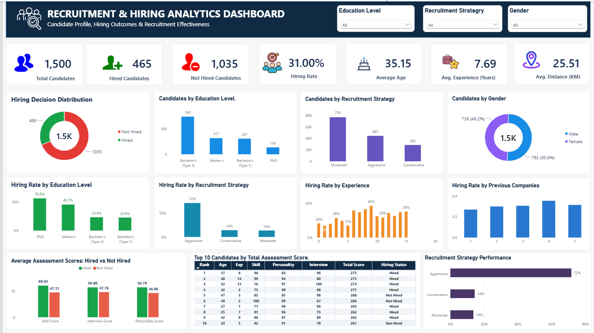

# Recruitment & Hiring Analytics Dashboard

## Project Overview
This project analyzes candidate profiles, recruitment strategies, assessment scores, and hiring outcomes using PostgreSQL, SQL, and Power BI.

The goal is to understand hiring patterns and present recruitment performance through an interactive dashboard.

## Dashboard Preview

## Dataset
- Total candidate records: 1,500
- Original columns: 11
- Missing values: 0, based on validation performed
- Target variable: `hiring_decision`
- Hiring outcome: `0 = Not Hired`, `1 = Hired`

## Tools & Technologies
- PostgreSQL
- SQL
- Microsoft Power BI
- Power Query

## Project Objectives
- Analyze candidate and hiring statistics.
- Calculate overall hiring rates.
- Compare hiring outcomes across education levels and recruitment strategies.
- Compare assessment scores for hired and non-hired candidates.
- Explore candidate experience and profile characteristics.
- Visualize key results in an interactive dashboard.

## SQL Analysis
The project includes 25 analytical SQL questions using:
- Aggregation and grouping
- CASE statements
- Subqueries
- Common Table Expressions (CTEs)
- Window functions and RANK()

## Power BI Dashboard
The dashboard includes:
- Seven KPI cards
- Hiring decision distribution
- Candidate distribution by education, gender, and recruitment strategy
- Hiring rates by education, strategy, experience, and previous companies
- Average assessment scores by hiring outcome
- Top 10 candidates by total assessment score
- Slicers for education level, recruitment strategy, and gender

## Key Results
- Total candidates: 1,500
- Hired candidates: 465
- Non-hired candidates: 1,035
- Overall hiring rate: 31.00%
- Average candidate age: 35.15 years
- Average experience: 7.69 years

## Business Value
This project demonstrates how SQL analysis and Power BI visualization can support recruitment reporting, hiring outcome analysis, and assessment score comparisons.

The findings describe patterns in the dataset and do not establish causation.

## Repository Structure
- `SQL/` — SQL scripts and analytical queries
- `Power Bi/` — Power BI dashboard file
- `Screenshots/` — Dashboard preview
- `Data/` — Dataset source and access instructions

## Disclaimer
This project is for educational and portfolio purposes. Findings are based on the available dataset and may not generalize to other recruitment environments.

## SQL Analysis

This project includes 25 SQL queries covering:

- Total candidates and hiring distribution
- Overall hiring rate
- Candidate profiles by age, experience, gender, and education
- Hiring rates by education level and recruitment strategy
- Interview, skill, and personality score comparisons
- Previous company experience analysis
- Candidate assessment rankings using SQL window functions

## Key Findings

- Total candidates analyzed: 1,500
- Candidates hired: 465
- Candidates not hired: 1,035
- Overall hiring rate: 31.00%
- Average candidate experience: 7.69 years
- Average interview score: 50.56

## Business Recommendations

- Compare hiring rates across recruitment strategies to identify approaches worth investigating further.
- Review interview, skill, and personality scores alongside hiring outcomes.
- Analyze candidate profiles by education and experience to understand hiring patterns.
- Use the Power BI dashboard filters to explore recruitment outcomes across different candidate groups.

## Project Files

- `recruitment_analytics.sql` — SQL queries and database setup
- `Recruitment_Hiring_Analytics_Dashboard.pbix` — interactive Power BI dashboard
- `Dashboard.png` — dashboard screenshot

## Tools Used

PostgreSQL | SQL | Microsoft Power BI
